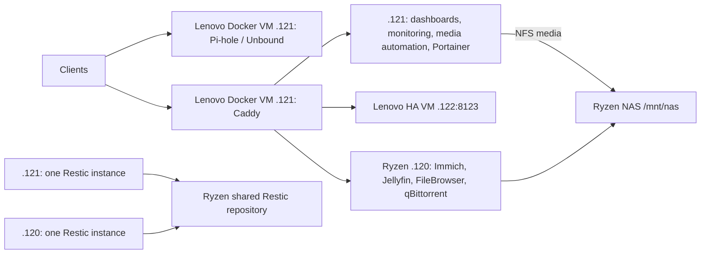

# Architecture

Two physical servers: Ryzen provides storage and Lenovo runs Proxmox. There are only two Docker targets, `storage` and `docker`. Home Assistant is a separate VM on Lenovo, not a container.

`stacks/storage/` and `stacks/docker/` are deployment boundaries. Each child retains its own Compose project name, container names, network and application data paths. One Beszel agent per Docker host is sufficient. No retired Chromebox is required.

The root `.env` remains the primary configuration source; `make config` renders stack environments and `make config-check` verifies them. Caddy uses `STORAGE_HOST`, `DOCKER_HOST` and independently `HA_HOST`. Home Assistant retains its existing reverse-proxy route; configure trusted proxies on that VM for the Lenovo proxy address as needed.

Persistent application state is under `/opt/homelab/data`. Media is on Ryzen and shared by NFS; downloads and media paths are preserved. Backups include application state on both Docker hosts, selected NAS data, Caddy named volumes and Unbound state. See [coverage and consistency limits](backups.md). The shared backup disk is not an off-site backup.

Before changing production paths, follow [migration and rollback](migration.md). A Git move neither migrates a running container nor changes its existing mounts.
