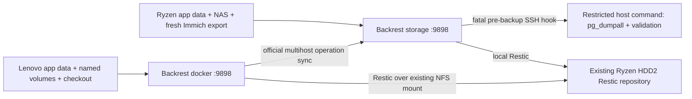

# Backrest backup management

Backrest manages the Restic engine on both Docker hosts. It reuses the **same existing encrypted repository**, password and historical snapshots. It does not replace Proxmox VM backups.

| Instance | Plan | Native daily schedule (`Europe/Amsterdam`) | Responsibility |
| --- | --- | --- | --- |
| Ryzen `storage` (.120) | `storage-data` | 02:00 | NAS/app backups, central dashboard, repository checks and maintenance |
| Lenovo `docker` (.121) | `docker-appdata` | 04:00 | Local application backups; sends operation history to Ryzen |



## Version and supported behavior

Both stacks pin official `ghcr.io/garethgeorge/backrest:v1.14.1` by manifest digest. It includes Restic 0.19.1. Multihost was introduced as **experimental** in 1.13; 1.14.1 fixes retention and snapshot download bugs. Both peers must remain compatible; review upgrades together.

Authoritative references for the pinned release:

- [Release notes](https://github.com/garethgeorge/backrest/blob/v1.14.1/CHANGELOG.md)
- [Official multihost pairing, permissions and shared-repository behavior](https://github.com/garethgeorge/backrest/blob/v1.14.1/docs/src/docs/multihost.md)
- [Hook events and fatal errors](https://github.com/garethgeorge/backrest/blob/v1.14.1/docs/src/docs/hooks.md)
- [Configuration schema](https://github.com/garethgeorge/backrest/blob/v1.14.1/proto/v1/config.proto)
- [Scheduling](https://github.com/garethgeorge/backrest/blob/v1.14.1/internal/protoutil/schedule.go)
- [Snapshot host/instance tags](https://github.com/garethgeorge/backrest/blob/v1.14.1/internal/orchestrator/repo/repo.go)
- [Repository-wide forget behavior](https://github.com/garethgeorge/backrest/blob/v1.14.1/internal/orchestrator/tasks/taskforget.go)

## Root configuration and persistence

Continue `nano .env`, `make config`, `make config-check`. Root values override committed stack defaults. `make config` additionally renders private desired repo/plan settings under ignored `.backrest/`. It never edits a running Backrest configuration. Apply managed changes explicitly with `sudo make backrest-config NODE=storage` or `NODE=docker` **while Backrest and legacy backup containers are stopped**. The helper reads the existing repository GUID with `restic cat config`; it never runs `init`. It reconciles the named local plan and `homelab` repo, preserves UI authentication, multihost identities/pairing and unrelated configuration, and keeps a private pre-change config copy. Backrest runs as root to read heterogeneous source ownership, and saves root-private configuration. Use `sudo` for the offline import/reconciliation helper. Do not edit generated JSON or overwrite live UI config. After changing schedules, use the same offline reconciliation and restart procedure.

`BACKREST_ENABLE_SCHEDULES=false` initially disables backup and integrity schedules; manual backups remain available for verification. Set it to `true` after migration tests. Native cron values are `BACKREST_STORAGE_CRON`, `BACKREST_DOCKER_CRON` and `BACKREST_CHECK_CRON` (Sunday noon, storage only). `TZ` controls local-clock scheduling. Cron schedules select the next future window after restart, rather than replaying every missed window. Inspect overdue/error history and run a manual backup after downtime. DST transitions can affect local windows; monitor them.

Keep each host's existing `RESTIC_REPO_PATH`: usually `/mnt/hdd2/restic` on Ryzen and `/mnt/nfs/backup/restic` on Lenovo. Both mount it as `/repo`, so repository URIs match without changing host paths. `RESTIC_PASSWORD` remains in the ignored root `.env` and the container environment; repo config references it by environment expansion rather than copying its value into generated JSON. Never regenerate it.

Persistent Backrest folders are under `${DOCKER_DATA}/backrest`: `config`, `data` (operation database/logs), `cache`, `tmp`, `restores` and storage-only `ssh`. `/restore` is the **staging** restore directory. Backup source mounts are read-only; Backrest state, repository and staging are writable. No privileged mode or Docker socket is used.

## Import and historical snapshots

`sudo make backrest-config` imports the existing GUID into the local `homelab` repo with `autoInitialize=false`, `autoUnlock=false`, no prune and no forget. Do not select Create/Initialize in the UI. Verify repo indexing and browse the **repository's snapshot list**, without a plan filter, to find historical `apps`, `infra`, `storage`, and `docker` snapshots. Plan views show only snapshots tagged for that Backrest plan. Historical files are not rewritten or retagged.

Instance ID and Restic hostname are distinct concepts. The config sets instance `storage`/`docker` and explicitly supplies `--host storage`/`--host docker`. Backrest adds `created-by:<instance>` and `plan:<plan-id>` tags. We retain `homelab` and storage's `media` tags for existing restore compatibility. Historical snapshots retain their original host/tags. Seeing old snapshots is not proof of recoverability: restore samples and compare bytes.

## First-time pairing (UI)

This setup uses **centralized monitoring with independently configured local repo records**, pointing to the same physical repository. Leave the repo's **Shared** toggle off. This avoids a pushed shared repo colliding with Lenovo's already-imported GUID, and lets root-generated local configuration remain authoritative. All Lenovo maintenance schedules are explicitly disabled.

1. Log in to Ryzen's UI, Settings → General; verify Instance ID `storage`. Verify Lenovo is `docker`.
2. On Ryzen, Settings → Multihost → Pairing Tokens → Generate. Label `docker-monitoring`, TTL **15 minutes**, Max Uses **1**. Grant **Read Operations** scoped to `plan:docker-appdata` (or `*` if you want all Lenovo operation history, including repository tasks). Do not grant Read/Write Config, Read Config or Receive Shared Repos.
3. On Lenovo, Settings → Multihost → Known Hosts → Add. Paste the one-time token and enter `http://192.168.1.120:9898` (adjust port). In the known-host permissions, explicitly grant Ryzen **Read Operations** for the same scope: this is the client-to-server operation upload direction in the pinned implementation. Save.
4. Verify both Settings pages show connected; verify the pairing secret is cleared and the token is consumed. Run a Lenovo backup and confirm its completed operation appears on Ryzen with instance `docker`. Scope errors/disconnects must not be treated as success. Never commit or paste tokens in issue/PR text.

The sync stream uses HTTP/2/h2c and its own encrypted peer transport. LAN firewall access and distinct persistent identities are required. Do not duplicate `config/sync` identity files across hosts. For shared-config mode later, consult the official bidirectional Receive Shared Repos permission requirements and local-GUID conflict rules; that mode is not enabled here.

| Action from Ryzen dashboard | Supported by this configuration |
| --- | --- |
| View Lenovo's synchronized backup operations/errors | Yes, while authorized and connected; retained history remains when offline |
| Run a Ryzen backup/check or restore from the shared repository into Ryzen staging | Yes, local operation |
| Browse Lenovo or historical snapshots in the shared repository | Yes, through Ryzen's local `homelab` repo, not remote execution |
| Remotely execute Lenovo backup/restore/check | No; sync has no such RPC. Use Lenovo's authenticated UI |
| Edit Lenovo configuration | No; Read/Write Config is deliberately not granted |

## Source coverage and live-data limitations

| Data | Plan / container source | Limitations |
| --- | --- | --- |
| Both hosts' `${DOCKER_DATA}` | `/sources/appdata` | Includes *arr, Homarr, Kuma, Beszel, Pi-hole, Portainer, Jellyfin and other app state |
| Existing `caddy_caddy-data` and `caddy_caddy-config` | Docker `/sources/volumes/...` | External volume identities retained; fail if absent instead of creating an empty substitute |
| `pihole-unbound_unbound-state` | Docker `/sources/volumes/unbound-state` | Trust anchor; Pi-hole config/dnsmasq remain under appdata |
| Checkout and local `.env`/Caddy/Pi-hole config | Both `/sources/checkout` | Includes private configuration, protected by repository encryption; excludes `.git`, `.bootstrap`, `.deploy-state`, `.backrest`, build/cache trees and `.partial` files |
| Selected NAS | Storage `/sources/nas/{Gallery,Files,Drive}` | No full media-library backup; excludes Movies, Shows, Music, Downloads |
| Fresh Immich logical exports | Storage `/sources/immich-exports` | Fatal snapshot-start hook creates and validates a fresh compressed SQL export before each storage backup |
| Immich live PostgreSQL | Excluded `/sources/appdata/immich/postgres` | Raw live database files are not a recovery method |
| Backrest config | Appdata `backrest/config` | Includes auth hashes and pairing identities; secure recovery copies |
| Backrest live DB, cache, tmp, restores, SSH keys | Excluded | Quiesced state copy and offline SSH-key custody described in recovery guide |
| Jellyfin `jellyfin-cache`, Immich `model-cache` | Not mounted | Rebuildable caches |
| Valkey, Docker socket, `/etc/localtime` | No persistent data backup | Cache/runtime resources |
| Portfolio | Image + checkout | No persistent application mount declared |
| Home Assistant and full VMs | Proxmox/HA backup workflow | Outside file-backup scope |

This audits tracked Compose declarations, not production. Inventory manual stacks and inspect running mounts before adoption. Custom `IMMICH_LIBRARY`, `FILEBROWSER_ROOT`, `MEDIA_ROOT`, `DOCKER_DATA` and `IMMICH_EXPORT_DIR` overrides need explicit review; only mounted/selected paths are covered. Lenovo must not back up NFS media.

Read-only source access does **not** freeze writers. Live SQLite and other database files can be inconsistent across files/WALs. Use supported online exports/SQLite backup API or an explicitly approved quiesced backup for *arr, Kuma, Beszel, Pi-hole, Jellyfin, FileBrowser, Homarr and Portainer; test restores. Caddy's certificate/config files are also a live copy: preserve a quiesced supplemental CA copy for disaster recovery. No backup task here stops applications automatically.

### Fresh Immich export

The storage plan uses `CONDITION_SNAPSHOT_START` + `ON_ERROR_FATAL` and `/hooks/immich-export.sh`. It authenticates to a **forced SSH command on Ryzen** with a dedicated key; the command can only call `immich-export-command.py`. That host helper executes the existing Compose `pg_dumpall` workflow, reads/validates the complete gzip stream and PostgreSQL SQL header, atomically publishes the archive under `IMMICH_EXPORT_DIR`, and returns nonzero on failure. Migration exports are not automatically deleted. Gzip/header validation is not a database restore test; periodically load the SQL in an isolated compatible database. Media files and SQL are not one atomic transaction.

See [migration](migration.md) for key installation. Missing SSH setup, a failed dump or validation aborts the snapshot, rather than silently relying on stale SQL. No additional cron/export container is used. The existing pre-upgrade Immich export remains; it now validates its output too.

## Maintenance and retention

Automatic destructive retention/prune remain disabled even after enabling backup schedules: **Keep All** on both plans, disabled repo forget/prune, no automatic unlock. Lenovo also has checks disabled. Ryzen alone schedules structural integrity checks; configure a periodic data-reading check in its UI after assessing repository size/runtime. Neither a structural check nor successful backup proves all historical pack data is readable.

The proposed policy (root `BACKREST_KEEP_DAILY=7`, `...WEEKLY=4`, `...MONTHLY=6`) is consumed only by:

```sh
# On Ryzen only, from repo root. Always --dry-run; this target cannot delete.
make backrest-retention-preview
```

The preview separately filters host **and** `created-by:<instance>,plan:<plan>` (comma means AND) and groups by host,tags,paths. It excludes untagged/historical Chromebox snapshots. Review proposed snapshot IDs and restore tests before an operator explicitly runs the corresponding scoped command without `--dry-run`, using Ryzen's Backrest Restic CLI/Run Command UI. No deletion-enabled script or native repo-wide forget schedule is installed. Backrest's native repo-wide scheduled forget uses **all snapshots grouped by tags**, so enabling it can delete historical snapshots too; do not use that as a shortcut. Plan retention must remain Keep All on Lenovo; it must not independently forget or prune.

After separately authorizing repository-wide pruning, coordinate both schedulers, confirm no active operations/locks and keep an independent repository copy. Do not force-unlock another host's active lock. Restic `--retry-lock 30m` waits for cross-host lock contention and eventually errors; Backrest's per-instance serialization is not a cross-host distributed scheduler. Stagger schedules/checks, monitor long media runs, and retry failed operations explicitly.

## Security and network

Set `BACKREST_BIND_IP` to the current host's LAN IP and `BACKREST_PORT=9898`. Never publish on `0.0.0.0` or a public interface. Authenticate before starting: initial config requires root `BACKREST_AUTH_BCRYPT`, base64 of a bcrypt password hash; later reconciliations preserve existing auth. UI/admin API authentication is enabled. Health checks test static HTTP readiness, not authorization or snapshot freshness.

No Caddy route, Cloudflare Tunnel entry or public port-forward is added. Basic HTTP on a trusted LAN does not encrypt browser login traffic; use SSH forwarding for administration or separately configured trusted internal TLS. Multihost peer crypto does not secure the browser UI. Keep pairing tokens short-lived/single-use and protect config state/restore files.

The Ansible firewall adds TCP 9898 for the configured LAN. For existing hosts inspect current UFW and Docker firewall rules before changing anything. Narrower examples (adapt subnet/addresses/ports):

```sh
# Ryzen: Lenovo sync, plus your admin workstation.
sudo ufw allow from 192.168.1.121 to 192.168.1.120 port 9898 proto tcp
sudo ufw allow from ADMIN_LAN_IP to 192.168.1.120 port 9898 proto tcp
# Lenovo: admin workstation only; Ryzen does not need inbound control access.
sudo ufw allow from ADMIN_LAN_IP to 192.168.1.121 port 9898 proto tcp
```

Docker published ports may bypass ordinary UFW INPUT rules; retain the repository's DOCKER-USER filtering, verify allowed/denied access from separate LAN/non-LAN clients, and do not assume adding a UFW rule creates isolation. Internet access is needed only for image pulls/updates, not for NFS repository operations or LAN sync.

## Repository verification

`make validate` renders every Compose template. Unit tests cover fail-closed import, authentication, retention scoping, export validation and historical restore selection. CI also runs `python3 scripts/test-backrest-integration.py`: it uses the local Docker socket explicitly, creates an internal-only test network and a temporary repository with sample apps/infra/storage/docker snapshots, verifies real pairing/history sync, exercises export-hook failure/success, restores new/historical bytes into staging, and checks repository integrity. It reads committed templates only, never a private root `.env`; only disposable test resources are removed. It must not be pointed at production or a remote Docker daemon.
