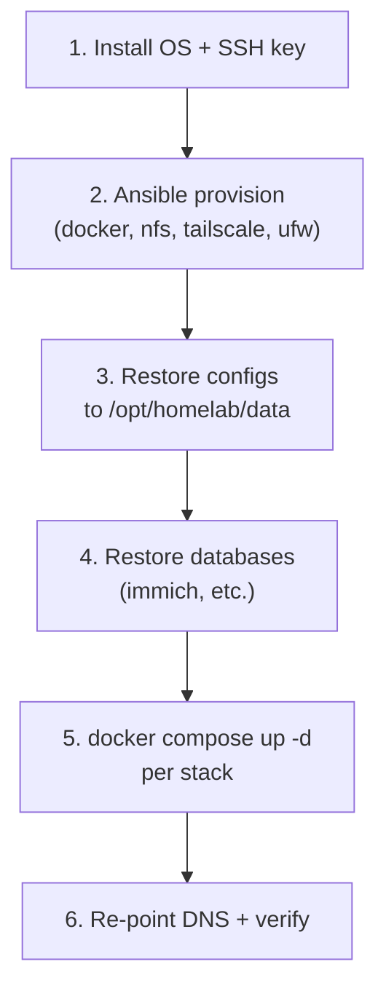

# Disaster recovery

How to recover from a lost container, a dead node, or a total rebuild.

## What is backed up, and where

| Data | Location | Protected by |
| --- | --- | --- |
| App configs & state | `/opt/homelab/data` | **restic** container stack (`stacks/<node>/restic`) → repo on `/mnt/hdd2/restic` — encrypted, deduplicated, versioned, per-host snapshots (tag `homelab`) |
| Immich database | Postgres (on ryzen) | Immich's built-in DB backup → `Gallery/backups/`, captured by the `media` snapshot (live `immich/postgres` is excluded) |
| Media & documents | `/mnt/nas/{Gallery,Files,Drive}` | RAID mirror **+ restic `media` snapshot** on `/mnt/hdd2` (backed up from ryzen by the `restic-media` service). Add an off-site copy for true 3-2-1. |
| Infrastructure as code | this git repo | git remote |

**Test restores periodically** — an untested backup is a hope, not a plan.

## Scenario 1 — A single stack is broken

```bash
cd stacks/<node>/<app>
docker compose down
./restore.sh              # newest config archive (or ./restore.sh <file>)
docker compose up -d
```

## Scenario 2 — A disk in the RAID fails

Replace the disk and let the array rebuild (mdadm/ZFS). If the whole array is lost,
restore the storage node's media snapshot with the staged recovery helper below,
provided the backup disk survived; otherwise use an off-site copy.

## Scenario 3 — Rebuild a node from zero



### Step by step

1. **OS + access.** Install Debian/Ubuntu, enable SSH, copy your key, set the static IP in `inventory.ini`.
2. **Provision.**
   ```bash
   cd ansible && ansible-galaxy collection install -r requirements.yml
   ansible-playbook site.yml --limit <node> -e tailscale_authkey=tskey-...
   ```
   (Rebuild **ryzen first** so NFS is up before apps/infra mount it.)
3. **Restore app state.** Set secrets, deploy the restic stack, then pull `/opt/homelab/data` back from the repo:
   ```bash
   cd ~/homeServer
   cp .env.example .env && $EDITOR .env      # restore secrets, incl. RESTIC_PASSWORD
   make config                               # regenerate per-stack .env files
   cd stacks/<node>/restic && docker compose up -d
   cd ~/homeServer
   # Replace apps with the actual node. Create only the parent /mnt/recovery first.
   python3 scripts/restic-restore.py apps homelab /mnt/recovery/apps
   # Review the preview, then repeat with --execute.
   ```
4. **Restore databases.**
   - **Media:** on storage, use `python3 scripts/restic-restore.py storage media /mnt/recovery/media --execute`. Files are staged under `/mnt/recovery/media/nas/`.
   - **Immich:** built-in dumps are in the restored `nas/Gallery/backups/`. Follow the restore instructions for the exact release and dump format. Pre-update `pg_dumpall` dumps in `NFS_BACKUP/immich` are separate. Do not restore over a running database or assume an image downgrade reverses migrations.
5. **Deploy.** `docker compose up -d` in each stack (or re-add the Portainer Git stacks).
6. **Re-point the network.**
   - Router DHCP DNS → infra node IP (Pi-hole).
   - Confirm `ryzen`/`apps`/`infra` resolve (Tailscale MagicDNS).
   - Set `DOMAIN`/`ACME_EMAIL` in the Caddy stack; Caddy re-issues certificates automatically.

## Scenario 4 — Total loss (all nodes)

1. Clone this repo.
2. Rebuild **ryzen** (Scenario 3) — it holds the data and NFS exports.
3. Restore app state **and** `/mnt/nas` media from the restic repo if `/mnt/hdd2` survived; if it didn't, restore both from your off-site copy.
4. Rebuild **apps** and **infra**.
5. Restore each stack's config + databases, deploy, re-point DNS.

## Recovery verification checklist

- [ ] All containers `healthy` (`docker ps`)
- [ ] Immich loads and shows the library; a test upload works
- [ ] Jellyfin plays media
- [ ] *arr apps reach indexers (Prowlarr) and the download client
- [ ] DNS resolves + ad-blocking active (Pi-hole query log)
- [ ] Caddy serves each `app.${DOMAIN}` over HTTPS
- [ ] Beszel shows all nodes reporting
- [ ] A fresh `docker exec restic backup` succeeds and `docker exec restic restic check` passes

## Keep off-box

### Staged recovery and restore drills

Never restore with `docker exec ... --target /` in backup containers: `/data` and
`/nas` are intentionally read-only. The helper uses a one-off container with a
separate writable `/restore` mount, filters by host and tag, and verifies bytes.
It refuses existing destinations and defaults to preview. Use `--snapshot ID`
for an exact snapshot. Create the parent directory first; allow enough staging
space for the full snapshot. Failed staging directories are retained; retry into
a new directory. Nothing is copied into live application data automatically.

App files appear under the staging directory's `data/` subdirectory, media under
`nas/`. Stop affected apps before copying selected data into `DOCKER_DATA` or
`MEDIA_ROOT`. Preserve the previous data directory before replacing it.

CI restores from a disposable encrypted restic repository containing two hosts,
verifying host selection and recovered bytes. Also test real snapshots and DB
imports on an isolated host periodically: repository integrity does not prove
application recovery. Off-site copies remain an operator responsibility.

### Credentials

Store these somewhere **not** on the homelab (password manager / encrypted vault):

- Each stack's `.env` (or at least the secrets)
- restic `RESTIC_PASSWORD` (without it the backups are unrecoverable)
- Immich `DB_PASSWORD`, Homarr `SECRET_ENCRYPTION_KEY`
- Tailscale auth keys, VPN (gluetun) credentials
